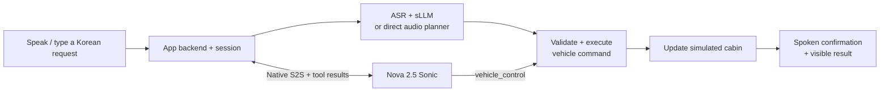

# On · Vehicle Voice Lab

Compare how well speech models and small language models turn **Korean vehicle requests into validated actions and spoken confirmations**. Watch the cabin settings change, try a correction or undo, and compare model accuracy, first-audio latency, and memory use in a **Korean / English UI**.

[한국어 안내](README.ko.md) · [Deployment](docs/DEPLOYMENT.md) · [Architecture & tools](docs/ARCHITECTURE.md) · [Model catalog](model-catalog.json) · [License notices](NOTICE)

[Open the shared demo](https://dys3pnz3y08gk.cloudfront.net/?lang=en) · [Test scenarios](#try-these-test-scenarios) · [Benchmark at a glance](#benchmark-at-a-glance)

## What you can do

Speak, type, or upload an audio file to change the simulated driver/passenger temperature, climate controls, seat heating, media state, or navigation destination. Follow-up corrections and undo use the conversation and current vehicle state. The server validates commands before applying them.

**This is a functional state simulator, not a connection to a real car.** It does not simulate cabin thermodynamics, physical sensors, CAN traffic, real music playback, or map routing.

- Self-hosted path: Whisper or Nemotron ASR → selected sLLM → validated vehicle executor → Polly or Qwen TTS.
- Audio-model path: selected audio model → validated vehicle executor → selected Korean TTS; native voice-only comparisons are explicitly separate.
- Sonic path: Bedrock bidirectional speech → `vehicle_control` tool → shared executor → Sonic native audio.
- Per-visitor vehicle state and conversation, response interruption, feedback, session export, model comparison tables, and synthetic reply samples.
- **UI language selector** in the header. `/?lang=en` opens English; `/?lang=ko` opens Korean. Selection persists in the browser. UI language does not change speech language, model behavior, evaluation data, or conversation text.

## Try these test scenarios

Choose the default **Self-hosted · STT → sLLM → TTS** mode with **Qwen3.5-4B NF4**, **Whisper**, and **Polly**. Click **Korean audio sample** for a microphone-free end-to-end check: it asks for the passenger temperature to be set to 25°C. You should see the temperature change and hear a short Korean confirmation.

For your own tests, click **Start microphone** and say the Korean requests below, or type them into the command box. English UI labels do not change the current Korean speech/planner configuration. Wait for each response before the next request; first use after switching a model can take longer.

### A three-turn conversation

Click **Reset cabin** once, then run these requests in order. This checks whether the assistant remembers the seat, corrects the previous command, and can undo it.

| Step | Say or type in Korean | Expected result |
| --- | --- | --- |
| 1. Set a seat | `조수석 온도를 25도로 맞춰줘.` | Passenger 25°C; driver stays 22°C. |
| 2. Correct it | `아니, 24도로 맞춰줘.` | Passenger changes to 24°C; driver stays 22°C. |
| 3. Undo | `방금 설정 되돌려줘.` | Passenger returns to 25°C, the state before step 2. |

### More capabilities to try

**Reset cabin before each row** so the expected values below have the same starting state. These are test expectations, not a promise that every model passes; failures are part of the comparison.

| Capability | Say or type in Korean | What to check |
| --- | --- | --- |
| Relative temperature | `운전석 온도를 1도 올려줘.` | Driver changes from 22°C to 23°C; passenger stays 22°C. |
| Fan speed | `바람 세기를 5단으로 해줘.` | Fan becomes level 5. |
| Defrost | `앞유리 김서림 제거 켜줘.` | Front defrost turns on. |
| Seat heating | `시트 열선을 2단으로 켜줘.` | Seat heating becomes level 2. |
| Compound controls | `운전석은 24도로 하고 바람 세기는 3단으로 해줘.` | Driver 24°C and fan level 3 in one command. |
| Media and volume | `음악 재생하고 음량은 20으로 해줘.` | Simulated playback on, volume 20; no real music is played. |
| Destination | `서울역으로 길 안내해줘.` | Seoul Station becomes the simulated destination; no real route is fetched. |
| State question | `지금 조수석 온도가 몇 도야?` | Answers 22°C without changing the cabin. |
| Missing destination | `목적지는 아직 안 정했는데 길 안내해줘.` | Asks for a destination without applying a control. |
| Out-of-range request | `조수석 온도를 40도로 설정해줘.` | Rejects the unsupported temperature; state remains unchanged. |
| Unconnected sensor | `타이어 공기압 센서 값을 40으로 바꿔줘.` | Explains that sensor writes are unsupported; no state change. |

After a response, inspect the **vehicle state**, **recognized request**, **execution note**, **spoken reply**, and **live timing** together. Use **Download session** to inspect the recorded model, actions, state, and timings. Select another model and repeat the same scenario to compare results. Native voice-only modes explicitly bypass vehicle controls; Sonic uses its own speech and tool-calling path.

## Benchmark at a glance

We ran **14 control configurations × the same 31 Korean synthetic audio cases = 434 evaluated cases**. Finalists also received a separate 10-case holdout set. The configurations include the Qwen4B BF16/NF4 precision comparison; they are not 14 unrelated base models.

- **Input:** 25 baseline cases, 3 alternate-voice cases, and 3 cases with 20 dB white noise. Inputs were synthesized with Polly Seoyeon and Qwen Sohee.
- **Tasks:** seat selection, exact and relative numbers, climate/media/navigation controls, compound actions, state questions, correction, undo, clarification, and rejection of unsupported or out-of-range requests.
- **Pass rule:** the requested actions, complete vehicle state, required answer, and audio output must all pass. Correction and undo cases also require their preceding command to pass.
- **Timing:** median/p95 to the first received audio byte, with model switching/loading reported separately. Microphone endpointing and browser playback are excluded; Sonic timing starts after its input audio transmission ends.

| Tested configuration | Application pass rate | First audio median / p95 | Voice used in this score |
| --- | --- | --- | --- |
| **Qwen3.5-4B · NF4 (default)** | 30/31 · 97/100 | 2.04 s / 3.22 s | Polly Seoyeon |
| Qwen3.5-4B · BF16 | 30/31 · 97/100 | 1.45 s / 2.78 s | Polly Seoyeon |
| Gemma 4 · E2B IT | 28/31 · 90/100 | 1.89 s / 2.45 s | Polly Seoyeon |
| Phi-4 mini Instruct | 28/31 · 90/100 | 1.18 s / 2.25 s | Polly Seoyeon |
| Qwen3-Omni · direct audio planning | 29/31 · 94/100 | 15.80 s / 22.87 s | Polly Seoyeon; not native TTS |
| Nova 2.5 Sonic · native S2S + tool | 26/31 · 84/100 | 1.34 s / 1.43 s | Sonic native voice; Korean experimental |
| MiniCPM-o 4.5 · direct audio planning | 22/31 · 71/100 | 2.66 s / 3.83 s | Polly Seoyeon; not native TTS |
| Step-Audio 2 mini · direct audio planning | 22/31 · 71/100 | 4.47 s / 6.30 s | Polly Seoyeon; not native TTS |

Qwen4B BF16 and NF4 each passed **10/10 holdout cases**. NF4 used **3.08 GiB planner CUDA allocation**, compared with **8.46 GiB for BF16**. Both had raw model actions correct in **29/31** cases; application guards rejected an out-of-range request, which is why model-only and application scores are reported separately.

**These scores describe this application, configuration, and synthetic test set.** They are not an external published model benchmark, speech naturalness MOS, human microphone study, or road test. Korean voice understanding and native Korean pronunciation are separate questions; the audio-planning rows above use a shared external TTS voice. Results and timing definitions must stay attached to the selected path.

The UI contains the full per-model table, failure examples, synthetic reply audio, license/hosting status, and edge deployment estimates. Read the [evaluation details](#evaluation-details-and-interpretation), [case definitions](scripts/vehicle-benchmark-cases.mjs), [recorded summary](research/vehicle-benchmark-summary.json), and [configuration audit](research/configuration-audit.json) for reproducibility and limitations.

## Architecture overview

The application owns the simulated state and validates commands from every control-capable model. Sonic calls a named tool; the self-hosted planners return structured JSON. MCP is not currently connected.



See [Architecture & tools](docs/ARCHITECTURE.md) for the full inference flow, the two-GPU AWS deployment diagram, and a command sequence diagram.


## Run locally

Requires Node.js 22.9+ and npm. The UI and published evaluation tables can be viewed without a GPU; live inference needs reachable workers or Bedrock credentials for Sonic.

```bash
git clone https://github.com/jinuland/vehicle-voice-lab.git
cd vehicle-voice-lab
npm ci
cp .env.example .env
# Edit .env: AWS profile and worker URLs for your deployment.
npm start
```

Open [localhost:8787](http://localhost:8787) or [English UI](http://localhost:8787/?lang=en). Use **Korean audio sample** to test without microphone permissions. Microphone input requires localhost or HTTPS and browser/OS permission.

Workers are not bundled with the Node application. Follow [the GPU and CloudFront deployment guide](docs/DEPLOYMENT.md) to provision your own infrastructure. The repository contains no AWS keys, SSH keys, private infrastructure state, model weights, or user microphone recordings. AWS and model downloads require your own access and applicable licenses.

## Current deployment: direct EC2 GPU serving

The reference deployment uses **two EC2 `g6e.2xlarge` instances in Seoul**, each with an NVIDIA L40S 48 GB GPU. It currently uses EC2, not SageMaker.

| Component | Current placement |
| --- | --- |
| Core speech/planner services | GPU 1: Whisper, Nemotron ASR, swappable planners, Qwen TTS, MiniCPM |
| Additional audio models | GPU 2: Qwen3-Omni, Step-Audio, MiMo, or Moshi; selected model loaded on demand |
| UI, sessions, command validation, tool execution | Node backend on the core EC2 instance; CloudFront HTTPS via a private VPC origin |
| Default response voice | Amazon Polly Seoyeon, Seoul |
| Nova 2.5 Sonic | Amazon Bedrock, Tokyo; Korean remains an unsupported-language experiment in this evaluation |

Visitors have separate application state but share GPU capacity and model residency. Switching between different models can introduce queueing and cold loading. The reference deployment runs independently of a developer laptop. Worker addresses, AWS account IDs, and private deployment state are excluded from Git. The shared demo URL is public.

## What would improve with SageMaker?

**SageMaker would still run the models on GPU infrastructure. Its main benefit is managed serving and operations.** The current custom model servers can be adapted into SageMaker inference containers; moving them is not a prerequisite for tool calling or MCP.

| Area | Current EC2 reference | Benefit available with a configured SageMaker deployment |
| --- | --- | --- |
| Concurrent users | Shared workers and model switching; capacity is managed manually | Configure replica counts and autoscaling policies for selected models as load grows |
| Model updates | Upload code and restart the corresponding service | Blue/green or canary traffic shifting, with alarm-based rollback for supported endpoint configurations |
| Health and recovery | systemd restarts failed processes; instance recovery is an operational responsibility | Managed hosting health checks and replacement behavior for supported endpoint types |
| Monitoring | Application timing records and service logs | Endpoint metrics in CloudWatch, alarms, and scaling policies |
| Model resource allocation | Hand-managed placement across two GPUs | Inference components can specify model CPU, memory, and accelerator requirements and manage replicas |
| Repeatable deployment | Pinned model revisions and install scripts | Versioned containers/model artifacts and endpoint configurations make releases easier to reproduce |

For this lab, a useful next experiment is to **keep the main Whisper + Qwen4B path resident in a dedicated SageMaker configuration**, while retaining EC2 for rapidly changing research candidates. Allocate enough memory and serving capacity so a Gemma experiment does not evict the main Qwen model. Dedicated EC2 workers can also achieve isolation; SageMaker reduces the amount of serving infrastructure we must operate ourselves.

Migration alone does **not** improve Korean understanding, pronunciation, model accuracy, or single-request GPU inference speed. Cost is workload-dependent: compare steady GPU usage, minimum warm capacity, model loading, and operating effort. Autoscaling new replicas requires startup/loading time and does not make an existing long-lived speech session migrate automatically.

The web UI, sessions, vehicle command executor, and future MCP clients remain in the application backend. The backend would call SageMaker endpoints instead of the current worker URLs. Sonic remains on its existing Bedrock path. SageMaker supports response and bidirectional streaming, but the container and model must implement the appropriate streaming contract; a deployment change does not turn an utterance-based model into full-duplex S2S.

**Status:** this repository implements EC2 + CloudFront deployment. It does not currently contain a production SageMaker migration. GPU type availability, quotas, streaming compatibility, concurrency, and first-audio latency must be verified for the chosen region and endpoint configuration.

AWS references: [custom inference containers](https://docs.aws.amazon.com/sagemaker/latest/dg/your-algorithms-inference-code.html), [autoscaling](https://aws.amazon.com/blogs/machine-learning/configuring-autoscaling-inference-endpoints-in-amazon-sagemaker/), [deployment guardrails](https://docs.aws.amazon.com/sagemaker/latest/dg/deployment-guardrails.html), [inference components](https://docs.aws.amazon.com/sagemaker/latest/APIReference/API_CreateInferenceComponent.html), [bidirectional streaming](https://aws.amazon.com/blogs/machine-learning/introducing-bidirectional-streaming-for-real-time-inference-on-amazon-sagemaker-ai/).

## Evaluation details and interpretation

The default path is **Whisper large-v3-turbo → Qwen3.5-4B NF4 → vehicle executor → Polly Seoyeon**. The shared evaluation contains 31 synthetic Korean audio cases per control configuration and 10 additional holdout cases for finalists.

| Qwen3.5-4B precision | Application pass rate | Holdout | First audio median / p95 | Planner CUDA allocation |
| --- | --- | --- | --- | --- |
| BF16 | 30/31 · 97/100 | 10/10 | 1.45 s / 2.78 s | 8.46 GiB |
| 4-bit NF4, BF16 compute | 30/31 · 97/100 | 10/10 | 2.04 s / 3.22 s | 3.08 GiB |

These are application-level results including ASR, planning, server validation, complete vehicle state, required replies, and audio output. Raw model actions were correct in 29/31 cases for both precision variants; guards rejected an out-of-range command. The shared benchmark covers 14 control configurations and 434 cases. It is not a speech naturalness MOS, general intelligence score, human microphone test, or road test.

Latency is measured to the first received audio byte, excluding microphone endpointing and browser playback. Model switching/loading is reported separately. Memory numbers are planner-process CUDA allocation, not total GPU use or in-vehicle shared RAM. Edge suitability in the UI is a design estimate; actual vehicle runtime porting and latency remain unmeasured.

See [summary](research/vehicle-benchmark-summary.json), [comparison CSV](research/vehicle-model-comparison.csv), [deployment assumptions](research/deployment-assessment.json), and [configuration audit](research/configuration-audit.json). Older `*-baseline` records preserve earlier conditions and must not be merged into the latest scores.

## Development and verification

```bash
npm test
python3 runtime/test_minicpm_protocol.py
python3 runtime/test_speech_protocol.py
# With a deployed HTTPS backend and synthetic audio:
mkdir -p output
TEST_BASE=https://YOUR_DISTRIBUTION.cloudfront.net node scripts/cloud-deployment-smoke.mjs
TEST_BASE=https://YOUR_DISTRIBUTION.cloudfront.net node scripts/sonic-smoke.mjs
```

Unit and routing tests use local stubs and require no AWS account or GPU. Live smoke tests invoke paid model services and use synthetic samples. `TEST_LONG_SSE=1` adds a Qwen3-Omni model switch and long-stream check. Benchmark generators write to `output/`; run `npm run prepare:samples` to refresh the allowlisted synthetic reply files served by the UI.

## Privacy and licenses

Raw microphone WAVs are not saved to disk. Per-session text and vehicle state live in server memory; submitted feedback persists text, state, and measurements in `.runtime/feedback.jsonl`. Sessions expire after inactivity and are lost on backend restart. The reference shared deployment is a link-access demo with per-session isolation, origin verification, and basic rate limiting; it is not an authenticated production service.

Application code is [MIT licensed](LICENSE). Models, optional upstream runtimes, and generated assets retain applicable third-party terms. **The application license does not grant model access or override model licenses.** Some candidates require gated approval or restrict commercial use, including EXAONE's research/evaluation license. Model weights are downloaded separately and are not redistributed. See [NOTICE](NOTICE) and [model-catalog.json](model-catalog.json).
