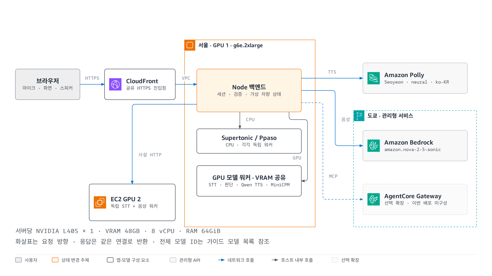
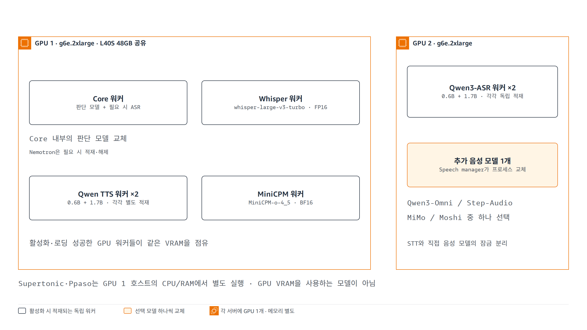

# 구현과 연결해서 읽는 아키텍처

[시작 안내](README.md) · [확대 가능한 아키텍처 그림](architecture.html) · [기존 영문 상세 문서](../docs/ARCHITECTURE.md)

이 문서는 저장소 코드에 구현된 연결 관계를 설명합니다. 서울 공유 배포의 실제 검증 절차와 결과는 [핸즈온 가이드](HANDS_ON.md)에 정리합니다.

## 공유 데모의 배포 구조

브라우저는 CloudFront의 HTTPS 주소에 접속합니다. 정적 화면과 API를 모두 Node 서버가 제공합니다. CloudFront는 VPC origin을 통해 첫 번째 EC2의 Node 서버로 전달하고, Node가 같은 호스트의 모델 워커 또는 두 번째 EC2의 음성 워커를 호출합니다.

| 연결 | 공유 배포 설정 | 코드 근거 |
| --- | --- | --- |
| 브라우저 → CloudFront | HTTPS, API 이벤트 스트림, Sonic WSS | [public/app.js](../public/app.js), [public/sonic-client.js](../public/sonic-client.js) |
| CloudFront → Node | VPC origin, HTTP `8787`, origin 검증 헤더 | [infra/deploy_cloudfront.py](../infra/deploy_cloudfront.py), [web-access.mjs](../web-access.mjs) |
| Node → 기본 워커 | loopback `9101` core, `9102` TTS, `9103` MiniCPM, `9105` Whisper | [scripts/deploy-web.py](../scripts/deploy-web.py) |
| Node → 추가 TTS | loopback `9106` Qwen 1.7B, `9107` Supertonic CPU, `9108` Ppaso ONNX CPU | [tts_worker.py](../runtime/tts_worker.py) |
| Node → Qwen3-ASR / 추가 음성 서버 | 사설 IP `9204` 프록시; 웹 서버 보안 그룹에서만 접근 | [infra/deploy_cloudfront.py](../infra/deploy_cloudfront.py), [scripts/deploy-web.py](../scripts/deploy-web.py) |
| Node → Polly | AWS SDK, 서울 기본값, 클라우드에서는 인스턴스 역할 | [server.mjs](../server.mjs), [aws-auth.mjs](../aws-auth.mjs) |
| Node → Sonic | Bedrock 양방향 스트림, 도쿄 기본값 | [sonic.mjs](../sonic.mjs) |
| Node → 외부 정보 도구 | IAM 서명 MCP → AgentCore Gateway → 제공자 Lambda / Web Search | [assistant-service.mjs](../assistant-service.mjs), [infra/deploy_assistant_tools.py](../infra/deploy_assistant_tools.py) |

첫 GPU 호스트에 Node와 여러 모델 워커를 함께 배치합니다. 그림에서 별도 박스로 보여도 별도 EC2라는 뜻이 아닙니다. 두 GPU 서버는 `g6e.2xlarge`를 사용하지만 모델을 유지·교체하는 단위가 서로 다릅니다.

각 서버의 하드웨어는 **NVIDIA L40S × 1 / VRAM 48GB / 8 vCPU / RAM 64GiB**입니다. 프로비저닝 코드의 EBS 설정은 GPU 1이 gp3 150GiB, GPU 2가 gp3 250GiB입니다. [AWS G6e 공식 사양](https://aws.amazon.com/ec2/instance-types/g6e/)과 [서버별 정확한 AI 모델 목록](MODELS.md)을 함께 참고하세요.

기본 요청의 모델은 `openai/whisper-large-v3-turbo`(FP16) → `Qwen/Qwen3.5-4B`(NF4, BF16 연산)이고, 실행기 안내 문구는 Amazon Polly의 `Seoyeon` / `neural` / `ko-KR` 설정으로 합성합니다. GPU의 제품명인 **L40S**와 그 위에서 실행하는 **AI 모델명**은 별개입니다.

전체 그림에서는 가독성을 위해 개별 워커와 포트를 묶고, 도구 제공자 내부 연결은 생략했습니다. 그 세부 관계는 위 표와 README의 도우미 흐름도에서 확인할 수 있습니다.

## GPU 상주와 요청 실행의 구분

**GPU 1**은 `vehicle-core`, `vehicle-whisper`, `vehicle-tts`, `vehicle-tts-qwen17`, `vehicle-minicpm`을 독립적인 systemd 서비스로 실행합니다. 각 활성 서비스는 시작하면서 모델을 같은 GPU에 적재합니다.

- Core 프로세스는 판단 모델을 로드하고 Nemotron ASR은 처음 요청할 때 로드합니다. `load_planner()`는 판단 모델·토크나이저·문법 객체를 비운 뒤 새 판단 모델을 로드하며 ASR 객체는 보통 유지하지만 Gemma 같은 큰 모델을 위한 여유가 부족하면 해제합니다. ASR은 다음 요청에서 다시 로드됩니다.
- Whisper, Qwen TTS 0.6B, Qwen TTS 1.7B, MiniCPM은 각각 별도 GPU 프로세스에 적재됩니다. `vehicle-tts-supertonic`은 같은 호스트의 CPU/RAM에서 실행합니다. 요청에서 다른 경로를 선택했다고 이 프로세스를 자동 종료하지 않습니다.
- 따라서 기본 요청이 Whisper와 Qwen을 사용하더라도, Core의 Nemotron과 활성화된 Qwen TTS·MiniCPM 워커가 VRAM을 함께 점유할 수 있습니다.

**GPU 2**의 `speech_manager.ensure()`는 선택한 모델이 바뀌면 `stop()`으로 기존 프로세스를 종료하고 새로운 음성 워커를 시작합니다. Qwen3-Omni·Step-Audio·MiMo·Moshi는 이 관리자의 대안 모델이며 하나씩 교체합니다. Qwen3-ASR 0.6B·1.7B는 별도의 상주 프로세스(9116·9117)와 모델별 대기열을 사용하므로 직접 음성 모델의 잠금과 분리됩니다.

상주는 메모리 점유, 요청 실행은 선택한 모델의 추론 호출을 뜻합니다. 서비스가 켜졌는지와 로딩이 성공했는지에 따라 실제 점유가 달라지므로, 이 구조 설명은 동시 적재 성공이나 동시 추론 성능을 보장하는 측정값이 아닙니다.

근거: [기본 워커 서비스](../runtime/bootstrap.sh), [Whisper 서비스](../runtime/bootstrap_whisper.sh), [MiniCPM 서비스](../runtime/bootstrap_minicpm.sh), [Core 로더](../runtime/model_server.py), [추가 음성 모델 관리자](../runtime/speech_manager.py).

## 로컬 실행과 공유 배포는 무엇이 다른가요?

| 항목 | 로컬 개발 경로 | 공유 HTTPS 배포 |
| --- | --- | --- |
| 웹 서버 위치 | 개발 PC의 Node, 기본 `127.0.0.1:8787` | 첫 번째 GPU EC2의 Node |
| 브라우저 접속 | localhost | CloudFront |
| 모델 연결 | 기본 URL `127.0.0.1:19101~19105`; 실행 스크립트가 원격 GPU SSH 터널 구성 | 같은 서버의 loopback `910x`, 두 번째 서버의 사설 프록시 |
| AWS 자격 증명 | 로컬 프로파일 등 설정한 credential provider | EC2 인스턴스 역할 |
| 모델 서버 없이 가능한 일 | 화면과 저장된 평가 자료 확인 | 배포된 화면·자료 제공 |
| 실제 음성 명령 실행 | 선택 경로에 필요한 모델 서버 또는 AWS API 접근 필요 | 선택 경로에 필요한 워커 또는 AWS API 접근 필요 |

`npm start` 자체가 GPU 모델을 다운로드·실행하는 것은 아닙니다. 로컬 기본 URL은 접속 지점이며, 모델이 개발 PC에서 추론된다는 뜻도 아닙니다. 실제 실행 절차는 [배포 안내](../docs/DEPLOYMENT.md)와 [scripts/start.py](../scripts/start.py)를 참고하세요.

## API로 보는 한 번의 요청

1. 브라우저가 `POST /api/session`으로 세션을 만들고 초기 차량 상태를 받습니다.
2. 일반 요청에 `x-session-id`를 붙여 자신의 상태를 지정합니다. Sonic은 WebSocket URL의 `session` 값을 사용합니다.
3. 선택한 경로로 요청합니다.

| 경로 | API | 핵심 처리 |
| --- | --- | --- |
| 단계형 | `POST /api/turn` | 음성 인식 → 텍스트 판단 → 검증·실행 → TTS |
| MiniCPM 제어 | `POST /api/minicpm-control` | `/plan-audio` → 검증·실행 → TTS |
| 다른 오디오 모델 제어 | `POST /api/audio-control` | 선택 모델 `/plan-audio` → 검증·실행 → TTS |
| Sonic | WebSocket `/api/sonic` | 음성 스트리밍 → `vehicle_control` → 도구 결과 → 음성 |
| 네이티브 음성 비교 | `/api/audio-native` 또는 `/api/s2s`에 `comparisonOnly: true` | 모델 고유 응답 비교, 차량 실행 없음 |

`/api/audio-native`, `/api/s2s`는 비교 플래그가 없으면 각각 제어 경로로 처리될 수 있습니다. URL 이름만 보고 “제어 없는 모드”라고 판단하면 안 됩니다.

일반 제어 응답은 `stage`, `reply`, `audio`, `done` 등의 이벤트를 SSE 형식으로 전달합니다. `reply`에 변경된 차량 상태가 포함되고, 음성은 그 뒤에 생성될 수 있습니다. **TTS 실패가 이미 반영된 차량 변경을 자동으로 취소하지는 않습니다.** 오류 이벤트에도 상태와 실패 단계가 들어 있으므로 화면 상태·검증 결과·음성 성공 여부를 각각 확인해야 합니다.

## 상태는 어디에 저장되나요?

`server.mjs`의 `sessions` Map이 사용자별 상태를 보관합니다. 별도 데이터베이스를 사용하는 구조가 아닙니다.

| 세션 값 | 용도 |
| --- | --- |
| `state` | 현재 온도·풍량·공조·미디어·모의 목적지, 변경 번호 `revision` |
| `previous` | 직전 차량 명령 이전 상태; 되돌리기에 사용 |
| `history` | 대화 맥락; 일반 판단 요청에서 최근 12개 메시지 사용 |
| `turns` | 입력, 제안 동작, 실행 결과, 오류, 처리 시간 등 요청 기록 |

실행기는 상태를 복제해서 명령 전체를 검사·적용한 뒤 성공한 결과만 돌려줍니다. 서버는 그 결과로 세션을 갱신합니다. 일반 제어 경로는 모델을 기다리는 동안 다른 요청이 상태를 바꿨는지도 `revision`으로 확인합니다.

Node가 재시작되면 메모리 세션은 사라집니다. 세션 ID는 앱 상태를 구분하는 수단이며 사용자 로그인 체계를 뜻하지 않습니다. 사용자별 상태 분리와 GPU 용량 분리도 별개입니다.

## 모델 비교 화면의 숫자는 어디에서 오나요?

실시간 요청의 측정값과 저장된 벤치마크 자료를 구분해야 합니다.

| 자료 | 생성·제공 경로 | 의미 |
| --- | --- | --- |
| 현재 요청 측정 | 서버의 요청 기록과 브라우저 재생 측정 | 이번 요청의 인식·판단·합성·재생 시간 |
| 비교표 | `research/vehicle-benchmark-summary.json` → `/api/benchmark` | 사전에 실행한 평가 결과 |
| CSV | `research/vehicle-model-comparison.csv` → `/api/benchmark-csv` | 모델별 결과 다운로드 |
| 응답 음성 예시 | `public/benchmark-audio/` | 저장된 모델별 시험 응답 |

같은 차량 실행기에 연결해야 언어 이해 차이를 비교하기 쉽습니다. 다만 STT·프롬프트·양자화·응답 TTS가 다르면 점수와 시간은 **그 설정 조합 전체의 결과**입니다. 응답 음성 파일의 모델명이 항상 목소리를 생성한 모델을 뜻하지도 않습니다.

모델 로딩 시간과 첫 음성 재생 시간은 서로 다릅니다. 단계형·직접 음성·Sonic은 측정 시작점도 다를 수 있으므로 원본 결과의 측정 필드를 함께 확인하세요.

## 코드를 읽는 추천 순서

1. [vehicle.mjs](../vehicle.mjs): 상태 구조와 실제로 지원하는 동작 확인.
2. [server.mjs](../server.mjs): 세션, 요청 분기, 실행 결과, 음성 응답 연결.
3. [planner-prompt-v2.mjs](../planner-prompt-v2.mjs): 현재 상태와 정정 표현을 모델에 어떻게 설명하는지 확인.
4. [runtime/](../runtime/): 선택한 경로의 모델 실행 방식 확인.
5. [sonic.mjs](../sonic.mjs), [assistant-service.mjs](../assistant-service.mjs): 실시간 음성과 외부 도구 확장.
6. [scripts/vehicle-benchmark-cases.mjs](../scripts/vehicle-benchmark-cases.mjs): 비교에 사용한 입력과 기대 동작 확인.

앱 코드 재사용, 모델 가중치 사용, 실제 차량 API 연동은 각각 별개의 작업입니다. 모델 가중치는 저장소에 없으며, 실차 제어와 영속 상태·사용자 인증을 갖춘 운영 시스템도 이 에셋의 구현 범위에 포함되어 있지 않습니다.
