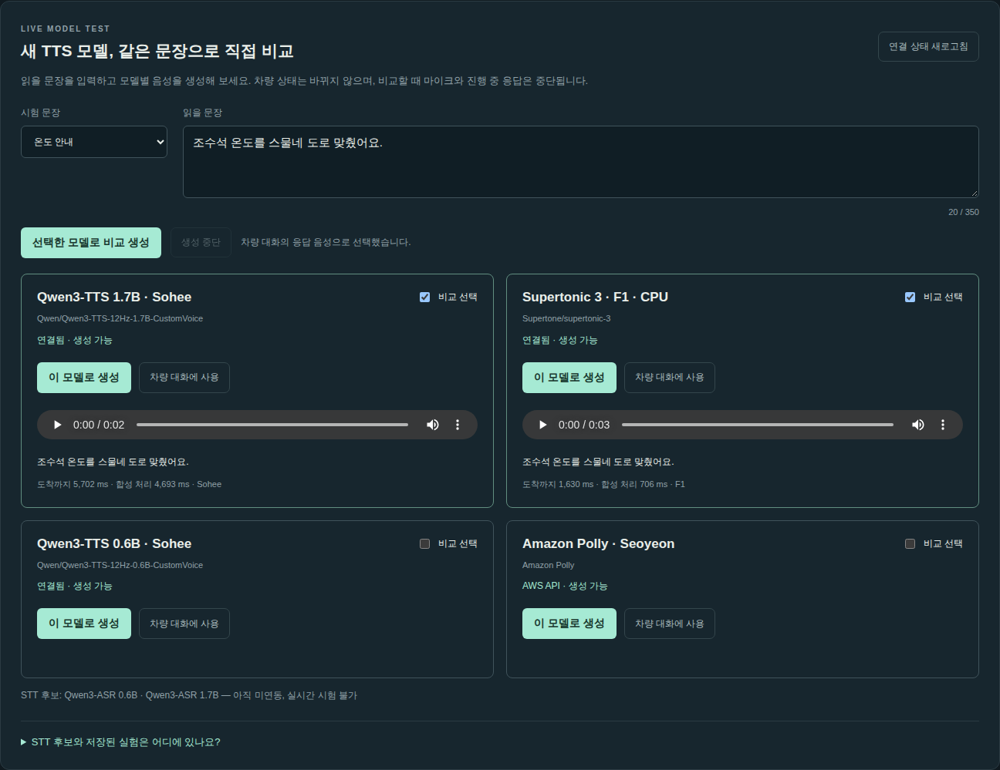

> **운영 업데이트:** 두 GPU 종료를 2026-10-23 06:08 / 06:10 KST(부팅 후 16시간)로 연장했습니다. [STT 4종 비교 실습](STT_COMPARISON.md)을 추가했습니다. 아래 과거 실행 시각보다 이 예약이 최신입니다.

# 서울 리전 차량 음성 랩 핸즈온

[앱 구조](README.md) · [GPU 상주 구조](diagrams/gpu-residency-ko.html) · [TTS 비교 음성](tts-comparison.html)

[서울 공유 데모 열기](https://d2ub6bbyf1c3sv.cloudfront.net/?lang=ko)

이 실습에서는 **Whisper → Qwen3.5-4B NF4 → 차량 실행기 → 선택한 TTS** 경로를 실행합니다. 응답 음성은 Polly, 기존 Qwen 0.6B, Qwen 1.7B, Supertonic 3를 비교합니다. 실제 자동차가 아니라 사용자별 서버 메모리의 가상 차량을 조작합니다.

<!-- VERIFIED_DEPLOYMENT_START -->
## 이번 서울 배포에서 확인한 결과

- 공유 URL: [https://d2ub6bbyf1c3sv.cloudfront.net](https://d2ub6bbyf1c3sv.cloudfront.net/?lang=ko)
- 검증 시점: `2026-10-22T10:58:17.336818+00:00`.
- 자동 테스트 32개, 기본 음성 제어·세션 분리, 기존 네 TTS의 12개 요청 검증 통과.
- [STT 4종 비교](STT_COMPARISON.md)와 [Ppaso ONNX CPU 합성·재인식](PPASO_TTS.md)은 별도 결과로 확인합니다. Kokoro는 제거했습니다.
- MiniCPM·Step-Audio 직접 음성 제어, Sonic 영어 및 한국어 실험 샘플 동작 확인.
- 브라우저 합성 마이크 입력·실제 오디오 재생 이벤트·취소·새 세션 상태 확인.
- 실제 사람의 마이크·소음 환경·청취 품질은 참가자 실습에서 별도로 확인.
- 이번 부팅 기준 자동 중지 예정: GPU 1 `2026-10-22T21:08:30+00:00`, GPU 2 `2026-10-22T21:10:17+00:00`. 재부팅하면 일정이 바뀝니다.

[기계 판독용 검증 요약](deployment-status.json). 이 검증은 모든 후보 모델·고난도 48문제·실차 성능을 통과했다는 뜻이 아닙니다. 이번 배포는 로컬 정보 제공자를 사용하며 AgentCore Gateway는 선택 확장으로 남겼습니다.
<!-- VERIFIED_DEPLOYMENT_END -->

## 실습 완료 기준

- HTTPS 브라우저에서 “조수석 온도를 25도로”를 입력하면 조수석만 25도가 됩니다.
- Qwen 1.7B와 Supertonic을 각각 선택하고 실제로 해당 모델의 음성이 반환되는 것을 확인합니다.
- “40도로”는 적용하지 않고 기존 상태를 유지합니다.
- 다른 브라우저 세션에 자신의 차량 상태가 섞이지 않습니다.
- 취소한 요청의 뒤늦은 음성이 재생되지 않습니다.
- 실습 종료 후 GPU를 중지하고 남는 리소스를 식별할 수 있습니다.

음성 재인식 점수·잡음 억제 실험과 앱 기능 검증은 별개입니다. 기존 31개 음성 점수나 새 48문제 명세를 배포 검증 통과로 대신 사용하지 않습니다.

## 1. 준비

운영자가 먼저 자신의 AWS 계정에 환경을 배포하고, 참가자는 공유 HTTPS URL로 접속하는 방식을 권장합니다. 참가자마다 GPU 두 대를 만들 필요는 없습니다.

운영자 준비 사항:

- AWS CLI v2와 로그인된 프로파일. 기본 예시는 `default`입니다.
- 서울 리전 `ap-northeast-2`의 VPC·서브넷, 인터넷 연결.
- EC2 G 계열 On-Demand GPU 할당량: `g6e.2xlarge` 두 대 기준 16 vCPU.
- EC2·IAM·CloudFront 리소스를 만들고 이 프로젝트 리소스를 관리할 권한.
- Node.js 22.9 이상, Python 3, SSH/SCP, 로컬 음성 변환용 ffmpeg.
- 모델 워커는 스크립트에서 **Python 3.12**를 별도로 설치합니다. DLAMI 기본 Python 버전을 그대로 사용하지 않습니다.

```bash
aws sts get-caller-identity
aws configure list-profiles
aws service-quotas get-service-quota \
  --service-code ec2 --quota-code L-DB2E81BA \
  --region ap-northeast-2 --query 'Quota.Value'
```

계정·프로파일이 의도한 대상인지 확인합니다. 자격 증명, SSH 개인키, `.runtime` 내용 전체는 공유하거나 커밋하지 않습니다.

## 2. 로컬 코드 확인

저장소 루트에서 실행합니다.

```bash
npm ci
npm test
cp .env.example .env
```

`.env`에서 `AWS_PROFILE`, `AWS_REGION`을 자신의 값으로 설정합니다. Python 배포 스크립트는 `.env`를 자동으로 읽지 않으므로 셸로 가져옵니다.

```bash
set -a
. ./.env
set +a
export AWS_REGION=ap-northeast-2
```

`npm test`는 차량 원자성·취소·세션·TTS 라우팅 등을 검사합니다. 실제 GPU나 Polly 호출 없이 통과해야 합니다.

## 3. GPU 두 대 생성

자신의 VPC와 서브넷을 확인합니다.

```bash
aws ec2 describe-vpcs --region ap-northeast-2 \
  --query 'Vpcs[].{Id:VpcId,Default:IsDefault}'
aws ec2 describe-subnets --region ap-northeast-2 \
  --query 'Subnets[].{Id:SubnetId,Vpc:VpcId,AZ:AvailabilityZone,Public:MapPublicIpOnLaunch}'
aws ec2 describe-instance-type-offerings --region ap-northeast-2 \
  --location-type availability-zone \
  --filters Name=instance-type,Values=g6e.2xlarge
```

사용 가능한 AZ에 있는 서브넷을 선택합니다. 아래 `YOUR_...`를 실제 값으로 바꾸세요. 이번 배포에서는 Ubuntu 24.04 PyTorch 2.12 DLAMI `ami-050f756cf5f8aef77`을 사용했으며, 나중에 재현할 때는 해당 AMI의 가용성을 확인해야 합니다.

```bash
export AWS_VPC_ID=vpc-YOUR_VPC
export AWS_SUBNET_ID=subnet-YOUR_SUBNET
export AWS_AMI_ID=ami-050f756cf5f8aef77
umask 077
mkdir -p .runtime
ssh-keygen -t ed25519 -f .runtime/vehicle-key -N '' -C vehicle-voice-lab
python3 infra/provision.py
python3 infra/provision_speech.py
python3 scripts/gpu.py status
```

기존 `.runtime/vehicle-key`나 배포 상태가 있으면 새 키로 덮어쓰지 말고 해당 배포를 이어서 사용합니다. 같은 로컬 상태 파일을 사용하는 프로비저닝 명령은 기존 인스턴스를 재사용합니다.

기대 결과: 두 인스턴스가 `running`, 유형은 `g6e.2xlarge`, 리전은 `ap-northeast-2`. 생성 직후에는 `pending`일 수 있습니다. 부팅과 cloud-init 완료 후 다음 단계로 진행합니다.

구성: 서버당 NVIDIA L40S 1개, GPU 메모리 48GB, 8 vCPU, 시스템 RAM 64GiB. **4시간 자동 중지 타이머**가 생성됩니다. 자동 중지는 모델 설치·검증 시간도 포함하며, 인스턴스를 다시 시작하면 부팅 시점부터 다시 계산합니다.

## 4. 모델 워커 설치

```bash
python3 scripts/bootstrap-workers.py --worker core \
  --with-minicpm --with-tts-candidates
python3 scripts/bootstrap-workers.py --worker speech
```

첫 실행은 Python·CUDA 라이브러리·모델 가중치를 다운로드하므로 웹 코드 배포보다 오래 걸립니다. SSH 연결을 유지하고 로그를 확인하세요. 명령이 종료됐다는 것과 모델이 GPU에 모두 로딩됐다는 것은 다릅니다.

| 위치 | 서비스 | 내부 포트 |
| --- | --- | --- |
| GPU 1 | `vehicle-core` | 9101 |
| GPU 1 | `vehicle-tts` — Qwen 0.6B | 9102 |
| GPU 1 | `vehicle-minicpm` — 선택 설치 | 9103 |
| GPU 1 | `vehicle-whisper` | 9105 |
| GPU 1 | `vehicle-tts-qwen17` | 9106 |
| GPU 1 CPU | `vehicle-tts-supertonic` | 9107 |
| GPU 2 | `vehicle-speech` — 모델 하나씩 교체 | 9104 |

모델 포트는 loopback에만 바인딩합니다. 인터넷에 열지 않습니다. CPU Supertonic도 GPU 1 호스트의 CPU/RAM을 쓰지만 GPU 모델은 아닙니다.

```bash
python3 scripts/gpu.py logs
python3 scripts/gpu.py tunnel
```

터널을 실행한 터미널은 그대로 두고, 다른 터미널에서:

```bash
curl --fail http://127.0.0.1:19101/health
curl --fail http://127.0.0.1:19105/health
curl --fail http://127.0.0.1:19106/health
curl --fail http://127.0.0.1:19107/health
npm start
```

브라우저에서 `http://127.0.0.1:8787`에 접속합니다. 기대 결과는 `ready: true`와 선택한 모델 ID·리비전입니다. Qwen 1.7B와 Supertonic은 각각 다음 값이어야 합니다.

- `Qwen/Qwen3-TTS-12Hz-1.7B-CustomVoice` / `0c0e3051f131929182e2c023b9537f8b1c68adfe`
- `Supertone/supertonic-3` / `3cadd1ee6394adea1bd021217a0e650ede09a323`

## 5. CloudFront HTTPS 공유 배포

```bash
python3 infra/deploy_cloudfront.py
```

처음에는 VPC origin 상태가 `Deploying`일 수 있습니다. AWS에서 생성이 완료된 뒤 같은 명령을 다시 실행합니다. 새 리소스를 직접 중복 생성하지 않습니다.

배포 URL이 출력되면:

```bash
python3 scripts/deploy-web.py
```

이 명령은 Node 앱, 허용된 정적 파일과 가이드, 합성 시험 음성만 업로드합니다. 개인키·개발자 AWS 자격 증명·`.env`·`.runtime` 전체는 업로드하지 않습니다. 웹 호스트의 AWS 호출은 인스턴스 역할을 사용합니다.

CloudFront가 `Deployed`가 된 뒤 출력된 HTTPS URL을 사용합니다. 모델 연결은 GPU 1 내부 loopback과 GPU 2의 사설 프록시를 사용합니다. 참가자는 SSH 터널이나 AWS 키 없이 브라우저로 접속합니다.

후속 웹 업데이트도 `scripts/deploy-web.py`를 사용합니다. 캐시가 남으면 자신의 배포 ID에 대해 무효화합니다.

```bash
aws cloudfront create-invalidation \
  --distribution-id YOUR_DISTRIBUTION_ID --paths '/*'
```

워커 코드 업데이트는 별도입니다.

```bash
python3 scripts/gpu.py deploy --worker core
```

모델·패키지 변경 시에는 해당 워커 설치·로딩 검증도 다시 수행합니다. 웹 배포만으로 GPU의 Python 환경이 갱신되지는 않습니다.

## 6. 배포 후 자동 검증

```bash
export TEST_BASE=https://YOUR_DISTRIBUTION.cloudfront.net
node scripts/cloud-deployment-smoke.mjs
node scripts/cloud-tts-smoke.mjs
```

검사 범위:

- 정적 파일·카탈로그·저장된 평가표 접근.
- 합성 음성 → Whisper → Qwen3.5 NF4 → 조수석 25도 변경.
- 별도 방문자 세션의 상태 유지.
- Polly·Qwen 0.6B·Qwen 1.7B·Supertonic 각각의 텍스트/음성/범위 밖 요청.
- 실제 TTS 모델 ID, 새 모델의 리비전, WAV 형식·샘플레이트.
- “40도” 요청 후 기존 25도 유지와 거부 안내.

기대 결과는 스크립트 종료 코드 0과 `passed: true`입니다. TTS 검증 상세는 `.runtime/cloud-tts-validation.json`에 저장됩니다. 단지 HTTP 200이거나 목소리가 들린다는 것만으로 통과시키지 않습니다.

Sonic을 사용하는 실습이라면 도쿄 Bedrock 모델 접근을 확인한 뒤 별도로 실행합니다. 한국어는 공식 지원으로 간주하지 않습니다.

```bash
node scripts/sonic-smoke.mjs
```

모델 교체·SSE 장시간 유지까지 확인하려면:

```bash
TEST_LONG_SSE=1 node scripts/cloud-deployment-smoke.mjs
```

이 검사는 Qwen3-Omni를 로드하며 첫 실행이 오래 걸릴 수 있습니다. 특정 모델만 미리 받으려면 GPU 2의 `/opt/vehicle-speech`에서 `HF_HOME=/opt/vehicle-speech/models omni-env/bin/python cache_speech.py --model step-audio2-mini`처럼 실행할 수 있습니다. 기본 배포 검증에서는 MiniCPM과 Step-Audio를 `scripts/cloud-audio-paths-smoke.mjs`로 확인했습니다. 모든 모델을 다 검증한 것으로 해석하지 않습니다.

## 7. 참가자 브라우저 실습

대화 패널에 바로 보이는 **응답 음성** 선택에서 모델을 바꾸고 다음을 반복합니다. 판단 모델과 STT는 **모델·음성 설정**에 있습니다. 초기에는 텍스트로, 이후 마이크로 시험하면 인식 문제와 판단 문제를 분리하기 쉽습니다.

| 순서 | 요청/조작 | 기대 결과 |
| --- | --- | --- |
| 1 | 초기화 후 “조수석 온도를 25도로 맞춰줘.” | 운전석 22도 유지, 조수석 25도 |
| 2 | “아니, 24도로.” | 조수석만 24도 |
| 3 | “조수석 온도를 40도로.” | 24도 유지, 허용 범위 안내 |
| 4 | “지금 조수석 온도가 몇 도야?” | 24도라고 답하고 상태 유지 |
| 5 | 응답 도중 취소 | 뒤늦은 응답 음성이 이어서 재생되지 않음 |
| 6 | 다른 시크릿 창에서 접속 | 새 차량 상태는 양쪽 22도 |
| 7 | Qwen 1.7B / Supertonic을 각각 선택 | 선택한 모델명과 실제 응답 기록 일치 |

■ 중단은 진행 중 요청·응답 음성을 중단하며, 이미 반영된 차량 상태를 되돌리지는 않습니다. 상태 복원은 별도로 “방금 설정 되돌려줘”를 사용합니다.

`/api/tts`에서 워커 준비 상태를 확인할 수 있습니다. 로딩 중인 자체 TTS는 선택이 비활성화됩니다. 존재하지 않는 TTS 이름을 API로 보내면 400을 반환하며 Polly로 몰래 바꾸지 않습니다.

마이크 실습은 HTTPS에서 권한을 허용해야 합니다. 실제 사람·실제 마이크의 음질과 브라우저 자동 재생 정책은 참가자가 확인해야 하며 서버 자동 시험으로 대체할 수 없습니다.

## 새 모델 테스트 UI 사용법

1. 앱 상단 **새 모델 테스트**로 이동합니다.
2. **읽을 문장**에 원하는 한국어 문장을 입력하거나 시험 문장 목록에서 고릅니다.
3. Qwen 1.7B·Supertonic 등 비교할 모델을 체크하고 **선택한 모델로 비교 생성**을 누릅니다.
4. 각 카드의 재생 버튼으로 같은 문장을 비교합니다. 생성에 사용한 문장·모델·시간이 결과와 함께 표시됩니다.
5. **차량 대화에 사용**을 누르면 해당 TTS를 대화 패널에 적용합니다.

이 기능은 TTS만 호출하므로 차량 명령을 실행하지 않습니다. 합성 음성이 마이크에 다시 들어가는 것을 막기 위해 마이크와 진행 중 대화 응답을 중단합니다. Qwen3-ASR 두 모델은 별도 STT 비교 화면에서 시험할 수 있고, CosyVoice·Kokoro의 저장된 실험은 별도 링크로 제공합니다.



## 이번 벤치마크 UI와 실행

**이번 벤치마크**에서 31개 음성과 고난도 48개 음성을 전환합니다. 14개 설정의 진행 수, 앱 결과, 모델 원안 동작, 지연과 실패 상세를 확인할 수 있습니다. **이 모델로 대화**는 실제 대화 설정을 선택합니다. 이전 환경의 점수는 아래의 접힌 **이전 평가 기록**에 보존합니다.

운영자 실행 순서:

```bash
# 기존 GPU 터널을 실행해 Qwen 0.6B의 두 번째 합성 목소리를 사용할 수 있게 합니다.
python3 scripts/gpu.py tunnel
# 다른 터미널에서 실행
AWS_PROFILE=default node scripts/generate-vehicle-benchmark.mjs
AWS_PROFILE=default node scripts/generate-hard-benchmark-audio.mjs
python3 scripts/start-deployment-benchmarks.py
```

기존 입력 파형은 저장소에 없으므로 동일한 31개 문장·합성 설정으로 다시 생성했습니다. 모든 모델에는 그 공통 파형을 사용하며 SHA-256을 기록합니다. 고난도 48개도 공통 합성 음성을 사용합니다. 총 본문 입력은 **1,106개(31×14 + 48×14)**이며 선행 요청·환경 재시도는 별도입니다.

평가용 Node API는 같은 EC2의 loopback `8788`에서 별도 실행됩니다. 웹 배포로 평가가 중단되지 않도록 소스를 고정했고, 공개 UI에는 읽기 전용 결과만 제공합니다. 고난도 fixture 주입은 고정된 case ID와 비공개 운영자 키가 필요하며 공개 앱에서는 비활성화됩니다. 키·환경 파일은 공유하지 않습니다.

- 기존 31개: 이전 판정 규칙에 맞춘 앱 성공률입니다. 모델 원안 동작도 따로 기록합니다.
- 고난도 48개: 고정 선행 상태·대화를 사용합니다. 자동 동작·상태 판정과 답변 의미 검토를 분리합니다.
- Sonic: 이전 대화를 시스템 문맥 데이터로 전달하고 현재 음성은 실시간 전송합니다. 다른 경로와 시간 기준이 다릅니다.
- 실행 환경 오류가 연속되면 중단해 조사합니다. 원래 오류 시도는 보존하고 수정 후 별도로 재실행합니다.

이번 전체 평가 동안 자동 중지는 **부팅 후 16시간**, 현재 부팅 기준 **2026-10-23 06:08~06:10 KST**로 연장했습니다. 새 환경의 기본 타이머는 여전히 4시간이며, 타이머를 바꾸면 private state의 `autoStopHours`와 가이드도 함께 갱신해야 합니다.

## 8. 고난도·잡음·TTS 비교 실습

- [48개 고난도 문제](HARD_BENCHMARK.md): 선행 대화를 먼저 수행하고 해당 상태인지 확인한 뒤 평가 발화를 입력합니다. 선행 단계부터 틀렸다면 본 문제 실패와 분리합니다.
- [TTS 3종 비교](tts-comparison.html): 숫자·부정·좌석과 짧은 문장의 발음을 직접 비교합니다. 표의 재인식 점수는 MOS가 아닙니다.
- [잡음 원본/처리본 비교](audio-lab.html#noise): 신호 잡음이 줄어도 인식이 나빠지는 사례를 확인합니다. 실험용 DSP·RNNoise는 앱 마이크 경로에 자동 적용하지 않았습니다.

추가 음성 모델 실습은 이번 서버에서 사전 로딩·검증한 **Step-Audio 2 mini**를 기본 선택으로 사용합니다. 다른 모델로 바꾸면 큰 가중치 다운로드와 교체 시간이 필요할 수 있습니다.

현재 48문제에는 가드·모델이 실패할 수 있는 사례도 포함합니다. “모두 통과해야만 배포 가능”이라는 기존 기능 회귀 기준과 동일하게 취급하지 말고 개선 연구용으로 별도 기록합니다.

## 9. 오류를 찾는 순서

| 증상 | 먼저 확인 |
| --- | --- |
| 웹이 열리지 않음 | 인스턴스가 자동 중지됐는지, CloudFront 상태, `vehicle-web` 서비스 |
| 403 | 올바른 HTTPS 배포 URL인지, origin 검증 설정·Host 일치 여부. 비밀값을 브라우저에 넣어 해결하지 않음 |
| GPU 준비 중 | 해당 `/health`, 워커 journal, 모델 다운로드·CUDA 메모리 |
| TTS 선택 불가 | `/api/tts`의 해당 모델 `ready`, 서비스와 내부 포트 |
| 화면은 바뀌는데 음성이 실패 | TTS 단계 오류. 이미 반영된 차량 상태를 자동으로 되돌리는 동작은 아님 |
| 모델 교체가 느림 | 로딩과 추론을 분리해 기록. 사용자별 상태가 달라도 GPU 모델은 공유 |
| 마이크만 실패 | HTTPS·권한·입력 장치·브라우저 처리 설정 |
| 숫자/좌석이 틀림 | 원문 전사와 모델 제안 동작을 각각 확인. 가드가 막은 것을 모델 정답으로 세지 않음 |

서버에 SSH로 접속한 상태에서 필요한 서비스만 조회할 수 있습니다.

```bash
sudo journalctl -u vehicle-web -n 80 --no-pager
sudo journalctl -u vehicle-tts-qwen17 -n 80 --no-pager
sudo journalctl -u vehicle-tts-supertonic -n 80 --no-pager
nvidia-smi
```

## 10. 실습 종료와 정리

```bash
python3 scripts/gpu.py stop
python3 scripts/gpu.py status
```

두 인스턴스의 `stopped`를 확인합니다. **웹 서버도 GPU 1과 함께 중지되므로 공유 URL은 더 이상 정상 응답하지 않습니다.** 중지해도 EBS·일부 네트워크/배포 리소스 비용은 남을 수 있습니다.

다음 실습에서 재사용하려면:

```bash
python3 scripts/gpu.py start
python3 scripts/gpu.py status
```

공인 IP가 바뀔 수 있으므로 상태를 갱신합니다. CloudFront VPC origin의 EC2 식별자는 유지되지만, 가동·서비스·사설 연결을 다시 검증합니다.

완전히 삭제할 때는 이 프로젝트의 `.runtime`에 기록된 리소스만 대상으로 CloudFront 비활성화·삭제 → VPC origin 삭제 → EC2 종료와 연결 스토리지 확인 → 전용 IAM 역할/프로파일·보안 그룹·키 쌍을 정리합니다. 다른 프로젝트의 기본 VPC·서브넷·인터넷 게이트웨이는 삭제하지 않습니다. 키와 상태 파일은 정리가 끝날 때까지 보관합니다.


## Ppaso 직접 시험

TTS 비교 화면에서 **Ppaso-TTS · 한국어 · ONNX CPU**를 선택합니다. 숫자·좌석·부정 표현을 각각 생성해 들어보세요. [모델과 실측 결과](PPASO_TTS.md)를 참고하세요.
