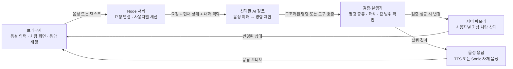
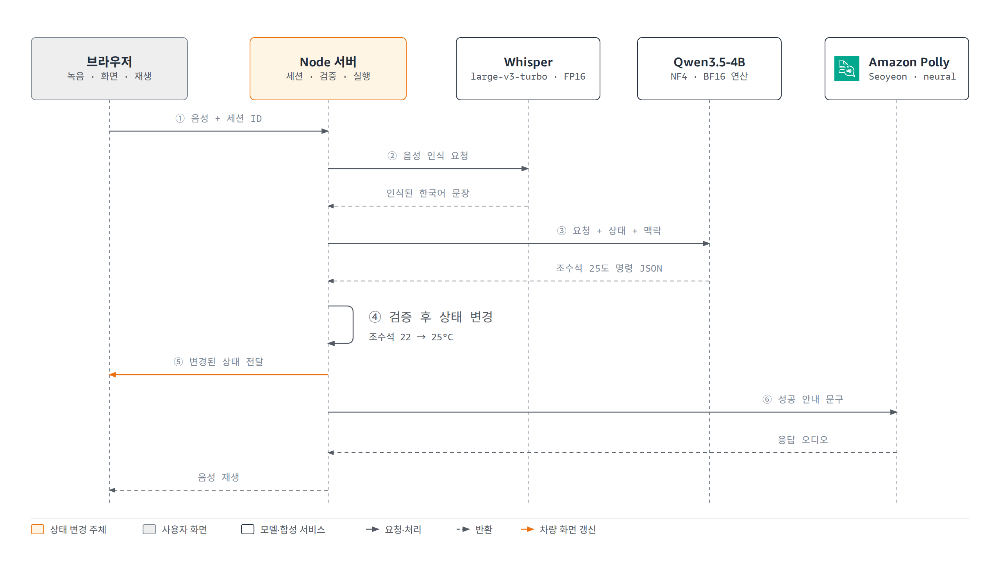
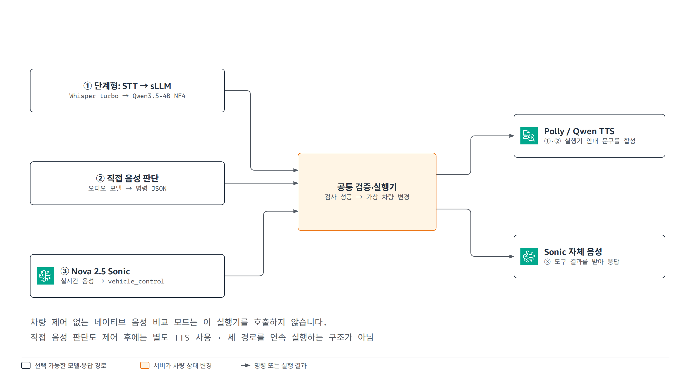
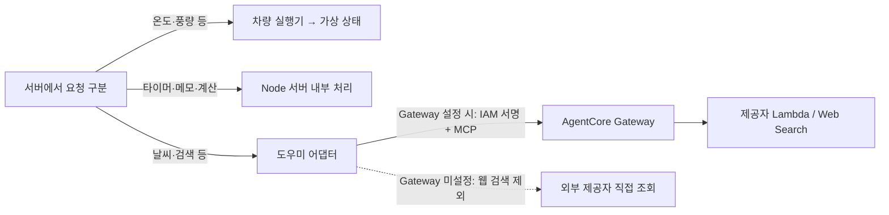
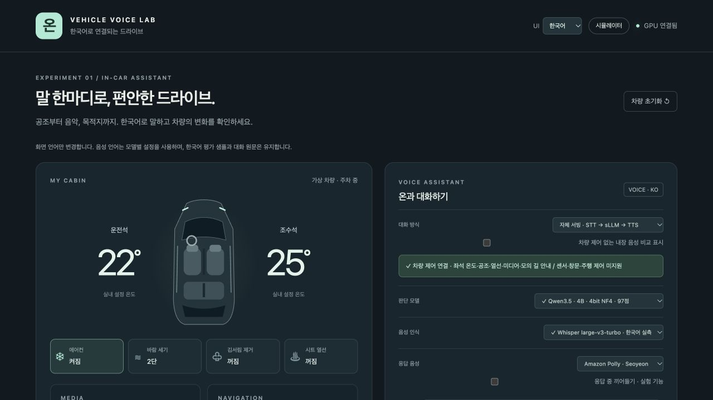

> **한국어 경량 TTS 교체:** Kokoro를 제거하고 [Ppaso-TTS](PPASO_TTS.md)를 ONNX CPU로 연결했습니다.


> **STT 비교 추가:** [Whisper / Nemotron / Qwen3-ASR 0.6B·1.7B 실습과 측정 방법](STT_COMPARISON.md). 동일 입력 824건 평가를 실행합니다.

# 차량 음성 랩: 구조와 동작 이해하기

이 에셋은 **한국어 음성을 차량 명령으로 바꾸는 AI 모델들을 같은 시뮬레이터에서 비교하는 웹 애플리케이션**입니다. 브라우저가 음성을 받고, 모델이 명령을 제안하고, Node 서버가 검증한 뒤 가상 차량의 상태를 바꿉니다.

처음에는 아래 **전체 구조 → 명령 처리 예시 → 세 가지 모델 경로** 순서로 읽으세요. AWS에 어떻게 배치되는지와 코드별 역할은 [아키텍처 상세 안내](ARCHITECTURE.md), 브라우저에서 확대해 볼 그림은 [AWS 아키텍처 다이어그램](architecture.html)에 있습니다.

**완성된 다이어그램:** [AWS 배포 구성](diagrams/deployment-ko.html) · [명령 처리 순서](diagrams/command-sequence-ko.html) · [모델 경로 비교](diagrams/model-paths-ko.html) · [GPU 모델 상주](diagrams/gpu-residency-ko.html). [한 페이지에서 전체 그림 보기](architecture.html).

**실습:** [서울 공유 데모](https://d2ub6bbyf1c3sv.cloudfront.net/?lang=ko) · [핸즈온 가이드](HANDS_ON.md). Qwen 1.7B·Supertonic 3를 실제 응답 음성으로 선택할 수 있습니다. 전체 벤치마크를 위해 이번 GPU 자동 중지는 부팅 후 8시간으로 연장했습니다.

## 1. 전체 구조: 화면, AI, 실행기는 각각 무슨 일을 하나요?



이 그림은 **논리적인 처리 흐름**입니다. 실제 네트워크 요청은 Node 서버가 중계하며, 검증·실행기와 차량 상태도 같은 Node 프로세스 안에 있습니다. 브라우저가 모델이나 차량 상태 저장소에 직접 접속하는 구조가 아닙니다.

| 구성 요소 | 맡은 일 | 대표 코드 |
| --- | --- | --- |
| 브라우저 | 녹음, 모델 선택, 차량 상태 표시, 응답 재생 | [public/app.js](../public/app.js) |
| Node 서버 | 세션 생성, 모델 요청, 결과 전달, 처리 시간 기록 | [server.mjs](../server.mjs) |
| 모델 실행 서버 | 음성 인식, 명령 판단, 음성 생성 | [runtime/](../runtime/) |
| 검증·실행기 | AI가 제안한 명령을 검사하고 가상 상태 변경 | [vehicle.mjs](../vehicle.mjs), [plan-guards.mjs](../plan-guards.mjs) |
| 도우미 어댑터 | 날씨·검색 등 외부 조회와 타이머·메모 처리 | [assistant-service.mjs](../assistant-service.mjs) |
| 평가 자료 | 같은 입력으로 모델별 정확도·시간 비교 | [research/](../research/), [scripts/](../scripts/) |

**AI가 “설정했어요”라고 말하는 것과 실제 상태 변경은 별개입니다.** 차량 제어 성공 여부는 서버 실행 결과와 화면의 변경된 값으로 확인합니다. 실차 연결은 없으며, 서버 메모리에 있는 온도·풍량 등의 값만 변경합니다.

## 2. “조수석 온도를 25도로 맞춰줘”는 어떻게 처리되나요?

기본적인 단계형 경로의 예입니다. 초기 조수석 온도는 22도입니다.



| 순서 | 처리 주체 | 입력 → 출력 |
| --- | --- | --- |
| ① 녹음 | 브라우저 | 사용자 발화 → 음성 데이터와 세션 ID |
| ② 음성 인식(STT) | Whisper 또는 Nemotron | 음성 → “조수석 온도를 25도로 맞춰줘” |
| ③ 명령 판단 | 선택한 sLLM | 요청 + 현재 상태 + 최근 대화 → 아래 JSON |
| ④ 검사 | 서버 | 제어 의도인지, 조수석인지, 온도가 16~30도인지 검사 |
| ⑤ 상태 변경 | 서버 실행기 | `temperature.passenger: 22` → `25`, `revision: 0` → `1` |
| ⑥ 응답 | 서버·TTS·브라우저 | 상태를 화면에 반영하고 “조수석 온도를 25도로 맞췄어요.” 재생 |

AI가 만드는 명령의 예:

```json
{
  "intent": "control",
  "actions": [
    {"type": "temperature", "zone": "passenger", "value": 25}
  ],
  "reply": ""
}
```

`intent`는 요청의 종류, `actions`는 실행할 동작 목록입니다. 성공 안내 문구는 실행기가 만들므로 이 예의 `reply`는 비어 있어도 됩니다.

“조수석 35도로”처럼 범위를 벗어난 요청은 적용하지 않습니다. 복합 명령도 하나라도 유효하지 않으면 전체를 적용하지 않습니다. 정정 표현인 “아니, 24도로”는 최근 대화와 현재 상태를 모델에 함께 보내 해석하고, “방금 설정 되돌려줘”는 서버가 보관한 직전 상태로 복구합니다.

## 3. 왜 음성 처리 방식이 여러 개인가요?

**같은 요청을 서로 다른 AI 구성으로 처리해 비교하기 때문입니다.** 아래 세 경로는 선택해서 사용하는 대안이며, 세 모델을 차례대로 모두 거치는 파이프라인이 아닙니다.



| 경로 | 이해·판단 | 응답 목소리 | 비교할 수 있는 점 |
| --- | --- | --- | --- |
| 단계형(cascade) | Whisper/Nemotron → Qwen/Gemma 등 선택한 sLLM | Polly 또는 Qwen TTS | 음성 인식 오류와 판단 오류를 나누어 분석 |
| 직접 음성 판단(audio control) | MiniCPM, Qwen3-Omni 등 지원 모델이 음성에서 명령 생성 | 별도로 선택한 한국어 TTS | 텍스트 STT 단계를 분리하지 않았을 때의 제어 정확도 |
| 실시간 Sonic | Bedrock의 Nova Sonic이 음성을 주고받으며 도구 호출 | Sonic 자체 음성 | 실시간 대화·중단·도구 호출 동작 |

### 정확히 어떤 모델을 쓰나요?

카탈로그가 지정한 **기본 단계형 구성은 Whisper large-v3-turbo → Qwen3.5-4B NF4 → 서버 실행기 → Polly Seoyeon**입니다. 아래는 저장소 설정 기준이며, 사용자가 모델을 바꾸면 선택한 구성으로 실행됩니다.

| 역할 | 정확한 모델 ID 또는 서비스 설정 | 실행 위치·정밀도 |
| --- | --- | --- |
| 기본 STT | `openai/whisper-large-v3-turbo` | GPU 1 · FP16 |
| 기본 판단 | `Qwen/Qwen3.5-4B` · 앱 ID `qwen35-4b-nf4` | GPU 1 · 4bit NF4, BF16 연산 |
| 기본 응답 음성 | Amazon Polly · `VoiceId=Seoyeon`, `Engine=neural`, `LanguageCode=ko-KR` | 서울 관리형 API |
| 대체 STT | `nvidia/nemotron-3.5-asr-streaming-0.6b` | GPU 1 · FP32 |
| 대체 TTS | `Qwen/Qwen3-TTS-12Hz-0.6B-CustomVoice` | GPU 1 · BF16 |
| 직접 음성 판단 | `openbmb/MiniCPM-o-4_5` | GPU 1 · BF16 |
| 실시간 음성 | Nova 2.5 Sonic · `amazon.nova-2-5-sonic` | 도쿄 Bedrock · 자체 GPU에 적재하지 않음 |

GPU 2의 선택 모델은 `Qwen/Qwen3-Omni-30B-A3B-Instruct`, `stepfun-ai/Step-Audio-2-mini`, `XiaomiMiMo/MiMo-Audio-7B-Instruct`, `kyutai/moshiko-pytorch-bf16`입니다. 이 중 Moshi는 차량 제어 없는 음성 비교용입니다.

Qwen3.5-4B의 BF16·NF4는 **같은 모델의 정밀도 변형**입니다. `4B`는 제품명이고 카탈로그의 전체 파라미터 수는 약 **4.66B**입니다. NF4가 전체 음성 파이프라인을 4bit로 실행한다는 뜻은 아닙니다.

→ [서버별 전체 모델·크기·정밀도·고정 리비전](MODELS.md)

**추가 검토 후보:** 한국어 STT에 **Qwen3-ASR-0.6B·1.7B**, 경량 TTS에 **Kokoro-82M**을 검토합니다. Kokoro는 한국어 음소 우회 입력으로 오디오를 생성했지만 차량 안내의 재인식 오류가 컸습니다. [한국어 실행 진단과 음성](KOKORO_KOREAN_TEST.md)을 확인하세요. MiniCPM-o 후속 여부와 최신 계열의 차이는 [모델 후보 검토](MODEL_CANDIDATES.md)에 정리했습니다. Kokoro와 Qwen3-ASR은 앱에 미연동이고 Qwen3-ASR은 아직 미평가입니다.

**한국어 TTS 후속 비교:** Supertonic 3·Qwen3-TTS 1.7B·CosyVoice 3를 같은 8문장으로 모두 실행했고, Qwen 1.7B·Supertonic은 공유 데모에 연동했습니다. [24개 음성 직접 비교](tts-comparison.html) · [설정과 결과 해석](TTS_COMPARISON.md). 재인식 기준 완전 일치는 각각 6/8·7/8·5/8이며 사람의 청취 품질 점수는 아닙니다.

텍스트 입력은 단계형 경로에서 STT를 건너뜁니다. 직접 음성 판단 모델이 반환하는 `heard`는 **모델이 이해한 요청**이며, 별도 STT로 얻은 원문 전사와는 다릅니다.

별도로 **차량 제어 없는 네이티브 음성 비교 모드**도 있습니다. 이 모드는 모델 자체의 응답 음성을 비교하며 실행기를 호출하지 않습니다. 따라서 자연스럽게 답해도 차량 값은 바뀌지 않습니다. Moshi는 현재 이 비교 경로에 한정됩니다. Sonic의 한국어 지원 여부는 이 저장소에서 `koreanSupported: false`로 표시하므로 한국어 기본 경로와 동등하게 지원한다고 읽으면 안 됩니다.

## 4. AWS에서는 어디에서 실행되나요?

공유 데모의 배포 코드 기준으로, **CloudFront 뒤에 서울 리전의 GPU 서버 두 대**가 있습니다. 첫 서버에는 웹 백엔드와 기본 모델들이 함께 있고, 두 번째 서버는 추가 오디오 모델을 실행합니다.

두 서버 모두 **`g6e.2xlarge`: NVIDIA L40S 1개, GPU 메모리 48GB, 8 vCPU, 시스템 RAM 64GiB** 구성입니다. GPU 1의 EBS는 gp3 150GiB, GPU 2는 gp3 250GiB로 프로비저닝 코드에 설정되어 있습니다. GPU 메모리는 서버별로 독립적입니다.


| 위치 | 실행되는 것 | 필요한 이유 |
| --- | --- | --- |
| 사용자 브라우저 | 웹 화면, 마이크, 스피커 | 음성 입력과 결과 확인 |
| CloudFront | HTTPS 접속과 Node 서버로의 전달 | 공유 데모 진입점 |
| 서울 EC2 GPU 1 | Node 서버 + STT·sLLM·Qwen TTS·MiniCPM 워커 | 세션 관리, 차량 실행, 기본 모델 추론 |
| 서울 EC2 GPU 2 | 추가 오디오 모델 워커 | Qwen3-Omni·Step-Audio·MiMo·Moshi 등의 선택 실행 |
| 서울 Amazon Polly | 한국어 음성 합성 | 단계형·직접 음성 판단 경로의 응답 읽기 |
| 도쿄 Amazon Bedrock | Nova Sonic | 관리형 실시간 음성 대화 |
| 도쿄 AgentCore Gateway 등 | 외부 정보 조회 도구 | 날씨·웹 검색 등 도우미 기능 |

### GPU에 올라간 모델과 요청에서 쓰는 모델은 다릅니다

**GPU 1은 여러 역할의 모델이 같은 L40S의 VRAM 48GB를 공유하는 구조**입니다. GPU 2는 추가 음성 모델을 하나씩 교체합니다.


| 서버·워커 | 활성화하고 로딩에 성공했을 때 GPU에 올라가는 모델 | 선택을 바꾸면? |
| --- | --- | --- |
| GPU 1 · Core | **판단 모델 1개 + 필요 시 Nemotron ASR**(앱 기본 Qwen3.5-4B NF4) | 판단 모델 교체. Nemotron은 필요 시 적재·메모리 부족 시 해제 |
| GPU 1 · Whisper | Whisper large-v3-turbo | 별도 워커로 상주 |
| GPU 1 · 기존 TTS | Qwen3-TTS-12Hz-0.6B-CustomVoice | 별도 GPU 워커로 상주 |
| GPU 1 · 추가 TTS | Qwen3-TTS-12Hz-1.7B-CustomVoice | 별도 GPU 워커로 상주 |
| GPU 1 호스트 CPU · Supertonic | Supertonic 3, F1 | CPU/RAM 사용. GPU VRAM 점유 모델이 아님 |
| GPU 1 · MiniCPM | MiniCPM-o-4.5 | 별도 워커로 상주 |
| GPU 2 · Speech manager | Qwen3-Omni / Step-Audio / MiMo / Moshi 중 하나 | 이전 모델 프로세스를 종료하고 새 모델 실행 |

GPU 1의 GPU 워커 다섯 개(Core·Whisper·Qwen 0.6B·Qwen 1.7B·MiniCPM)를 모두 활성화하면 **Core의 두 모델을 포함해 여러 모델이 함께 적재될 수 있습니다.** 모델마다 GPU가 따로 있는 것이 아니며, 선택한 모델 크기와 사용량에 따라 메모리 여유가 달라집니다. 워커 활성화·로딩 성공 여부를 확인하지 않고 실제로 모두 상주한다고 단정할 수는 없습니다.

**한 요청에서 사용하는 경로는 별개입니다.** 기본 요청은 `Whisper → Qwen3.5 → 서버 실행기 → Polly`, MiniCPM 요청은 `MiniCPM → 서버 실행기 → 선택한 TTS`입니다. 기본 요청에서 MiniCPM을 사용하지 않더라도 MiniCPM 워커가 켜져 있으면 메모리에 남아 있을 수 있습니다. Polly를 선택했다고 Qwen TTS 워커가 자동으로 내려가는 것도 아닙니다.

사용자별 차량 상태는 분리되지만 모델 로딩과 GPU 용량은 공유합니다. 여기서 상주는 **메모리에 올라가 있다는 뜻**이며, 여러 모델이 동시에 추론 중이거나 모든 모델을 매 요청마다 호출한다는 뜻은 아닙니다. 이 설명은 구현·배포 설정 기준이고 실제 배포 검증 범위와 접속 방법은 [핸즈온 가이드](HANDS_ON.md)를 참고하세요. 상주·메모리 사용량은 요청과 모델 선택에 따라 달라집니다.

→ [큰 아키텍처 그림 열기](architecture.html) · [배포 연결·포트·로컬 실행 차이 보기](ARCHITECTURE.md)

## 5. 날씨와 검색도 차량 명령인가요?

아닙니다. 온도 변경은 **차량 실행기**, 날씨·검색은 **도우미 어댑터**로 보냅니다. 단계형 경로에서는 STT 뒤의 애플리케이션 라우터가 정보 요청을 분기하므로 추가 sLLM 판단을 생략할 수 있습니다. Sonic은 별도 `assistant_tool`을 호출합니다.



MCP는 여기서 서버가 외부 도구를 발견하고 호출하는 통신 규약입니다. **차량 제어 명령은 Gateway를 통과하지 않습니다.** 차량 카드의 음악·목적지는 모의 상태이고, 실제 라디오 재생·외부 경로 조회는 도우미 기능입니다.

## 6. 잡음 제거는 어떻게 하나요?

현재 마이크 입력은 브라우저에 잡음 억제·에코 제거·자동 이득 조절을 요청하고, RMS 기반으로 발화 구간을 잡습니다. 서버의 명시적인 잡음 제거는 아직 없습니다. 업로드 WAV는 브라우저 마이크 처리를 거치지 않습니다.

별도로 **보수적 적응형 DSP 시제품과 RNNoise**를 같은 합성 잡음 입력에서 비교했습니다. 잡음이 줄어도 숫자·좌석 인식은 나빠질 수 있어 앱 기본값으로 켜지 않았습니다. [전처리 설계·실험 결과](AUDIO_FRONTEND.md)와 [원본/처리본 음성 비교](audio-lab.html#noise)를 확인하세요.

## 이 에셋에 포함된 것

프로젝트 이름은 **온 · 차량 음성 랩**입니다. 여기서는 저장소 전체를 하나의 에셋, 즉 가져다 살펴보고 활용할 수 있는 프로젝트 묶음으로 설명합니다. 코드, 데모 화면, 테스트 음성, 모델 비교 결과가 함께 들어 있습니다. 개별 음성·이미지 파일은 [파일 안내](FILES.md)에서 확인하세요.

## 무엇을 해볼 수 있나요?

| 해볼 일 | 예시 |
| --- | --- |
| 차량 기능 변경 | “바람 세기를 5단으로 해줘.” |
| 앞선 요청 정정 | “조수석 25도로.” → “아니, 24도로.” |
| 변경 취소 | “방금 설정 되돌려줘.” |
| 현재 상태 확인 | “지금 조수석 온도가 몇 도야?” |
| AI 모델 비교 | 같은 요청을 여러 모델에 보내 정확도와 응답 시간 비교 |
| 도우미 기능 | 날씨 조회, 라디오, 타이머, 메모, 비용 계산 등 |

차량 카드의 음악·목적지는 가상 상태입니다. 실제 방송을 재생하는 라디오와 외부 경로 조회는 별도 도우미 기능입니다.

## 이 프로젝트가 유용한 이유

차량 음성 비서를 만들기 전에 **어떤 AI를 쓸지, 한국어 숫자·좌석·정정 표현을 잘 이해하는지** 확인할 수 있습니다. 화면과 음성 처리 코드, 명령 검증 코드, 비교용 시험 자료를 함께 참고할 수 있습니다.

저장소에 기록된 평가는 14개 제어 설정에 같은 한국어 합성 음성 31개를 입력한 실험입니다. 이 점수는 이 앱의 시험 결과이며, 실제 운전자·주행 환경에서의 성능을 보장하지 않습니다.

기본 평가와 별도로 **[고난도 문제 48개](HARD_BENCHMARK.md)**를 준비했습니다. 발화 중 정정, 여러 턴의 대상 추적, 비대칭 온도 계산, 인용·가정, 복합 명령의 전체 거부 등을 다룹니다. 각 문제에 선행 대화·정답 동작·유지해야 할 상태·판정 근거가 있습니다. **아직 음성 생성이나 모델 평가를 실행한 결과는 아니며, 기존 31개 점수에 합산하지 않습니다.**

## 가장 쉽게 둘러보는 순서

1. 아래 화면 이미지로 앱의 모습을 확인합니다.
2. [파일 안내](FILES.md)에서 관심 있는 자료를 찾습니다.
3. 직접 체험하려면 [기존 한국어 안내](../README.ko.md)의 공유 데모와 테스트 시나리오를 참고합니다. 새 배포의 검증 결과와 자동 중지 설정은 [핸즈온 가이드](HANDS_ON.md)를 참고하세요.



로컬 실행 시 화면과 저장된 평가표는 GPU 없이 확인할 수 있습니다. 실제 AI 응답에는 별도의 모델 실행 서버나 AWS 서비스 접근 설정이 필요합니다. 설치 방법은 [배포 안내](../docs/DEPLOYMENT.md)에 있습니다.

## 자주 헷갈리는 말

| 용어 | 쉬운 뜻 |
| --- | --- |
| 모델 | 말을 이해하거나 답을 만드는 AI |
| STT / ASR | 음성을 글자로 바꾸는 단계 |
| sLLM | 비교적 작은 언어 AI. 여기서는 실행할 명령을 판단 |
| TTS | 글자를 읽어서 음성으로 만드는 단계 |
| 자체 서빙 | 준비한 서버에 AI 모델을 올려 직접 실행하는 방식 |
| 벤치마크 | 같은 문제를 풀게 해서 성능을 비교하는 시험 |

앱 코드는 MIT 라이선스이며, 연결해서 쓰는 AI 모델에는 각각 별도 이용 조건이 있습니다. AI 모델 본체인 가중치 파일은 이 저장소에 포함되어 있지 않습니다.