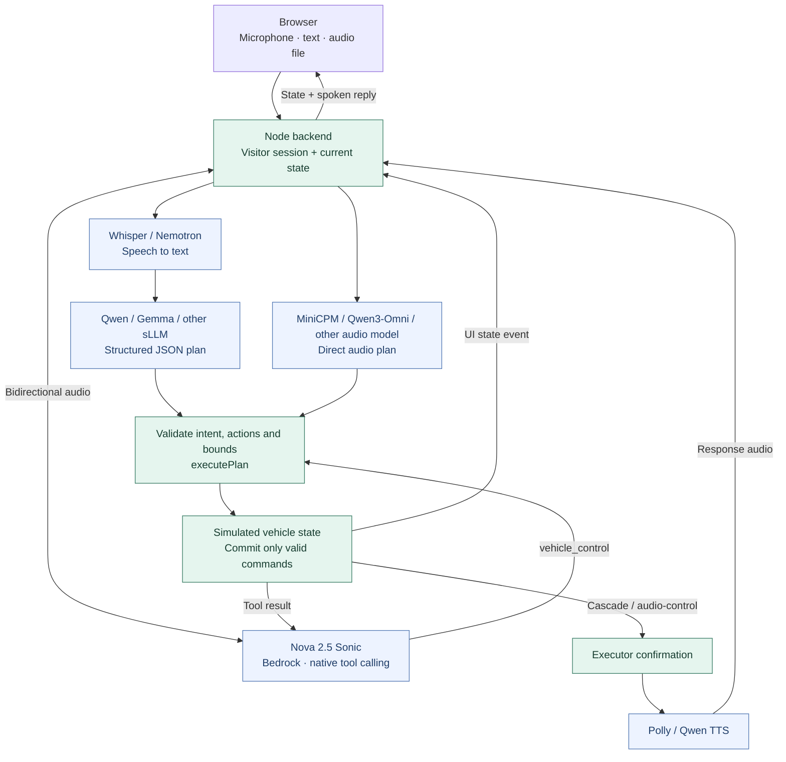
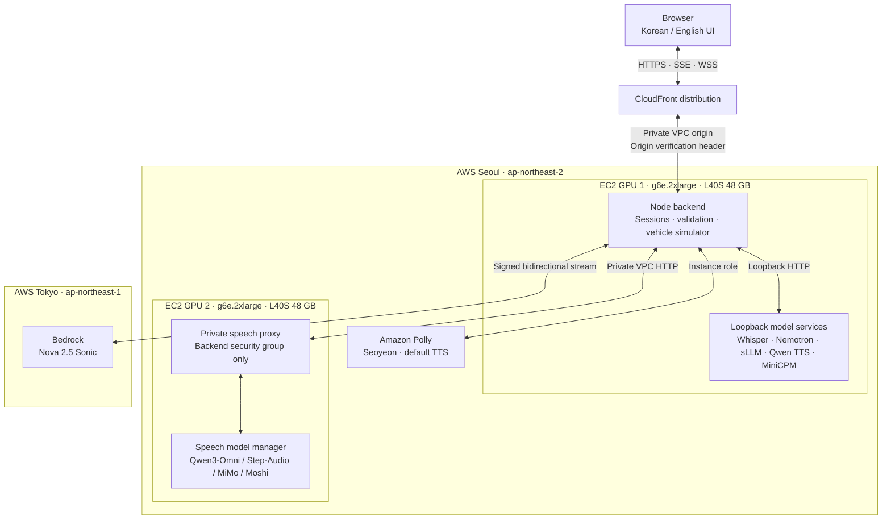
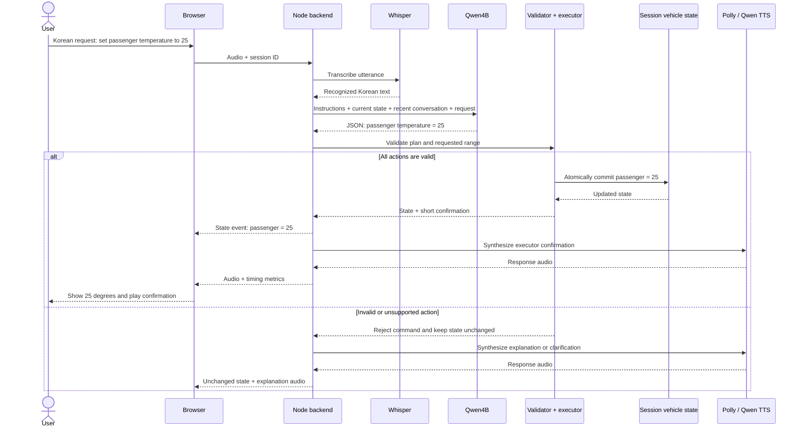

# Architecture and tools

The browser sends an utterance, a typed request, or a synthetic sample to the Node backend. The backend owns the visitor session and the authoritative simulated vehicle state.

## Runtime paths and the shared execution boundary

The model proposes a command; the application validates and executes it. The arrows below distinguish the structured planner path, direct audio planning, and Sonic's native tool calls. All control paths change the same kind of per-session simulated state.

Blue nodes are model inference services. Green nodes are application logic and state. For the cascade and direct-audio-control paths, the executor creates the short confirmation and a selected TTS service speaks it. For Sonic, the executor returns the tool result to Sonic, which generates its native spoken confirmation. The browser receives updated state and audio through the backend.

Explicit **native voice-only comparison** modes are omitted from this control diagram: they send audio to a selected model and return its native audio without calling the vehicle executor. Moshi is currently limited to that comparison path.

| Path | Understanding / planning | Execution | Spoken response |
| --- | --- | --- | --- |
| Cascade | Whisper/Nemotron ASR, then selected sLLM | Validated JSON actions → `executePlan()` | Polly or Qwen TTS |
| Audio control | Selected audio model outputs a plan directly from audio | Same executor and bounds validation | Selected Korean TTS |
| Sonic | Native bidirectional speech and `vehicle_control` tool calling | Tool handler → same executor | Sonic native speech |
| Explicit native comparison | Audio model's native dialogue | No vehicle control | Native audio output |

## Current AWS deployment

This is the implemented EC2 + CloudFront layout. Both GPU instances are in Seoul. The web backend shares the core GPU host, while the additional audio models use a second GPU host. Polly is a managed TTS API in Seoul; Sonic is a managed Bedrock model in Tokyo.

The GPU labels indicate host placement, not one GPU per model or simultaneous residency of every checkpoint. A selected planner/audio model can replace another on its worker. Visitors have separate vehicle sessions but share worker capacity and model loading. No developer laptop or SSH tunnel is required for the shared HTTPS deployment.

SageMaker is a proposed serving alternative, **not a component in the current diagram**. A migration would move selected model workers behind SageMaker invocation adapters; application sessions, validation, vehicle execution, and the browser remain application responsibilities. See [the README comparison](../README.md#what-would-improve-with-sagemaker).

## One command, from speech to an updated cabin

The following example follows the default Whisper → Qwen4B → executor → TTS path. The initial driver and passenger temperatures are 22°C. Only a fully valid command commits a new state; a compound request is validated as a whole before any of its actions is applied.

For a **typed request**, the ASR step is skipped. For **direct audio planning**, an audio model replaces the ASR + text-planner steps. For **Sonic**, streamed audio and a native `vehicle_control` call replace those steps, and the tool result returns to Sonic for its voice response. A clarification or unsupported request can also result in an empty action list and an explanation without changing state.

Diagram sources: [runtime](diagrams/runtime.mmd), [deployment](diagrams/deployment.mmd), [command sequence](diagrams/command-sequence.mmd).

## Instructions and validation

`planner-prompt-v2.mjs` defines the compact instructions: exact seat and numbers, current state, corrections, relative adjustments, all-or-nothing compound actions, and no unsupported claims. The backend appends current state and recent conversation. The sLLM worker constrains generation with a JSON grammar.

`vehicle.mjs` validates action names, types, limits, and control intent, applies a complete command to a cloned state, and commits only after every action is valid. `plan-guards.mjs` rejects silent clamping of out-of-range requests. Confirmations for cascade/audio-control paths are generated by the executor after success. Sonic receives the tool result before producing its confirmation.

This exercises language understanding, tool routing, validation, application state, and speech output. It does not establish physical vehicle safety or hardware integration.

## Tool calling and MCP

Sonic uses provider-native tool calling. Cascade planners output a structured action plan interpreted by the application; they do not currently use provider-native function calling. These paths share the same execution boundary.

**MCP is not currently connected.** A future backend MCP client can discover selected tools, adapt schemas to each model interface, validate arguments, execute a call, and return its result to the model. No model must speak MCP directly. Real vehicle integration requires an authorized vehicle API/gateway behind the executor. Tool results and externally retrieved content remain data, not permission to execute arbitrary commands.

## UI language

`public/i18n.js` localizes application-owned text and accessibility labels using reviewed dictionaries. A view-layer observer handles independently rendered tables and streaming status updates and retains original text for reversible language switches. It excludes user/model conversation bodies, original evaluation transcripts, and custom destination text. It never rewrites input values, action payloads, or speech language settings. `?lang=ko|en` takes precedence over the saved UI preference; Korean is the default.

## Sharing and deployment

CloudFront HTTPS connects through a VPC origin to the Node backend. The backend uses loopback for core workers and a security-group-restricted private proxy for the second speech server. Model ports are not internet-facing. The origin verifies a deployment-specific secret; browsers never receive it. API routes are not cached; model loading streams have heartbeats. AWS calls use an EC2 role in cloud mode.

Application sessions are isolated but GPU residency is shared. A model swap can delay requests from other sessions. Memory sessions are not durable across a Node restart. Authentication, tenant authorization, durable state, and load-tested serving capacity must be designed for production.
